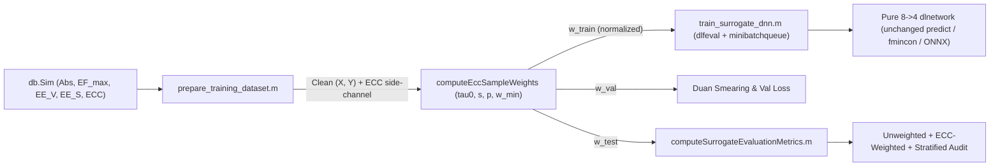

# ECC-Weighted Surrogate Training & Evaluation (Design Proposal)

- **Status:** Proposed / On Hold (documented for future ASSTEROID & manuscript updates)
- **Date:** 2026-11-16
- **Scope:** `Codebase/ASSTEROID/` (`prepare_training_dataset.m`, `train_surrogate_dnn.m`, `computeSurrogateEvaluationMetrics.m`, `trainingConfig.m`, `runTrainingWorkflow.m`)

---

## 1. Problem Statement & Motivation

Every full-wave 3D FEM simulation at $(P, r, \lambda)$ reports an Energy Conservation Check diagnostic (`db.Sim.ECC`):

$$\mathrm{ECC} = 1 - A_{\text{total}} - (R_{\text{total}} + T_{\text{total}})$$

where $T_{\text{total}} = 0$ on the optically thick gold mirror under the Impedance Boundary Condition (IBC). For an ideal, numerically exact FEM solution, $\mathrm{ECC} = 0$. As $|\mathrm{ECC}|$ grows, the simulation exhibits numerical energy-balance error (e.g., grazing-angle APML reflections or mesh discretization inaccuracy).

**Goal:** Incorporate $|\mathrm{ECC}|$ as a physics-grounded sample reliability signal so that:
1. During **training**, the surrogate downweights numerically noisy simulations instead of overfitting solver artifacts.
2. During **evaluation**, reliability-weighted and reliability-stratified diagnostics quantify how much residual error stems from imperfect FEM inputs versus surrogate generalization error.

---

## 2. Empirical Audit of `database.mat` (`db.Sim.ECC`, `db.Optima`, and `db.Model`)

An empirical audit of all `184,140` finite points (`6,138` geometries $\times$ `30` wavelengths) in `Database/database.mat` revealed four critical facts that govern the design:

### 2.1 Scale, Units, and Distribution
- `db.Sim.ECC` is stored as a **dimensionless fraction** in $[-0.0755, +0.1118]$ (so `0.01` $= 1\%$ energy-balance error), unlike `Abs` which is stored in percent $[0, 100]$.
- `NaN`/`Inf` count in `ECC`: `0 / 184,140`; out-of-bounds `Abs` ($< 0$ or $> 100$): `0 / 184,140`.
- Summary statistics: $\text{mean} = -1.29 \times 10^{-5}$, $\text{median} = -1.58 \times 10^{-6}$, $\text{std} = 1.62 \times 10^{-3}$.

| $|\mathrm{ECC}|$ Threshold | Points Exceeding | % of Dataset | Geometries with $\ge 1$ Wavelength Above |
| :--- | :---: | :---: | :---: |
| $> 0.0010$ ($0.10\%$) | 21,969 | 11.93% | 6,138 (100.00%) |
| $> 0.0015$ ($0.15\%$) | 16,118 | 8.75% | 6,056 (98.66%) |
| $> 0.0020$ ($0.20\%$) | 8,795 | 4.78% | 4,518 (73.61%) |
| $> 0.0050$ ($0.50\%$) | 2,104 | 1.14% | 1,292 (21.05%) |
| $> 0.0100$ ($1.00\%$) | 812 | 0.44% | 628 (10.23%) |
| $> 0.0200$ ($2.00\%$) | 174 | 0.09% | 170 (2.77%) |
| $> 0.0500$ ($5.00\%$) | 14 | 0.01% | 14 (0.23%) |

### 2.2 Physical Localization: Rayleigh–Wood Anomaly Clustering
High-$|\mathrm{ECC}|$ points are **not uniform random noise**. They cluster sharply along the **1st-order hexagonal Rayleigh–Wood diffraction threshold** ($\lambda_{\text{RA},1} = \frac{\sqrt{3}}{2} P$ in air):
- Median distance $|\lambda - \frac{\sqrt{3}}{2} P|$ is **$186.0\,\text{nm}$** for $|\mathrm{ECC}| \le 0.001$, dropping to **$33.2\,\text{nm}$** for $|\mathrm{ECC}| > 0.005$ and **$23.2\,\text{nm}$** for $|\mathrm{ECC}| > 0.010$.
- The worst samples lie within $< 0.3\,\text{nm}$ of $\lambda_{\text{RA},1}$ (e.g., $\mathrm{ECC} = +0.11185$ at $P = 947.6\,\text{nm}, \lambda = 820.9\,\text{nm}$ where $\frac{\sqrt{3}}{2}P = 820.7\,\text{nm}$; $\mathrm{ECC} = +0.07168$ at $P = 906.3\,\text{nm}, \lambda = 785.0\,\text{nm}$ where $\frac{\sqrt{3}}{2}P = 784.8\,\text{nm}$).
- **Optima Overlap (`db.Optima`):** Several modal optima neighborhoods ($R = 20\,\text{nm}$) around $P \approx 903\,\text{nm}$ ($r \approx 375\,\text{nm}$) and $P \approx 1160\text{--}1260\,\text{nm}$ reach $\max|\mathrm{ECC}| \approx 0.072\text{--}0.074$ (`~3%–4.6%` of neighbor wavelengths above `0.005`), coinciding with strong Surface Lattice Resonance (SLR) peaks ($\mathrm{EF}_{\max} \sim 1.8 \times 10^7$, $\mathrm{EE}_V \sim 965$).

### 2.3 Correlation with Current 4-Head `gs_tensor` Test Residuals (`18,420` Holdout Samples)
Evaluating the current `db.Model.Model` across the `614`-geometry test holdout split binned by $|\mathrm{ECC}|$:

| Target | $r(|\mathrm{ECC}|, |\Delta \log_{10}|)$ | NRMSE ($|\mathrm{ECC}| \le 0.001$, $n=16{,}211$) | NRMSE ($0.001 < |\mathrm{ECC}| \le 0.005$, $n=2{,}016$) | NRMSE ($|\mathrm{ECC}| > 0.005$, $n=193$) | Mean $|\Delta \log_{10}|$ ($\le 0.001 \to > 0.005$) |
| :--- | :---: | :---: | :---: | :---: | :---: |
| $\mathrm{Abs}$ | $+0.1243$ | 0.558% | 0.915% | **2.028%** | $0.0113 \to 0.0271$ |
| $\mathrm{EF}_{\max}$ | $+0.0713$ | 0.974% | 0.874% | 1.028% | $0.0373 \to 0.0741$ |
| $\mathrm{EE}_V$ | $+0.0796$ | 0.671% | 0.341% | 0.765% | $0.0230 \to 0.0449$ |
| $\mathrm{EE}_S$ | $+0.0430$ | 1.191% | 0.791% | 0.862% | $0.0455 \to 0.0737$ |

**Key Takeaway:** Far-field $\mathrm{Abs}$ NRMSE degrades by **$3.6\times$** and near-field log-space residuals roughly **double** for $|\mathrm{ECC}| > 0.005$. Soft downweighting acts as heteroscedastic noise regularization that prevents Rayleigh-edge $\mathrm{Abs}$ glitches from pulling surrogate gradients, while global unweighted NRMSE will shift only modestly because $|\mathrm{ECC}| > 0.01$ is `0.44%` of samples.

---

## 3. Critical Design Constraints & Traps to Avoid

1. **Never use hard culling or $w_{\min} = 0$:** Because high-$|\mathrm{ECC}|$ sits directly on the $\lambda \approx \frac{\sqrt{3}}{2}P$ Rayleigh ridge and inside Mode IV SLR optima, dropping those points creates a blind spot and allows unconstrained surrogate extrapolation at modal peaks. Always enforce a positive floor $w_{\min} > 0$.
2. **Respect channel asymmetry:** $\mathrm{ECC}$ directly measures far-field power-flux error ($\mathrm{Abs}, R_{\text{total}}, T_{\text{total}}$), whereas near-field integrals ($\mathrm{EE}_V, \mathrm{EE}_S$) at those same Rayleigh points still anchor peak resonance coordinates. Per-channel floors ($w_{\min,\mathrm{Abs}} < w_{\min,\mathrm{EE/EF}}$) are physically cleaner than a single aggressive scalar floor.
3. **Never replace unweighted evaluation metrics silently:** Always report standard unweighted Tier 1 & Tier 2 IDW metrics alongside ECC-weighted or ECC-stratified (`|ECC| <= 0.005` vs. `> 0.005`) diagnostics so reviewers cannot mistake downweighting of difficult Rayleigh regimes for cherry-picking.
4. **Keep `ECC` out of `X` and `Y`:** `ECC` is unavailable at dense-grid inference or `fmincon` optimization time; it belongs strictly in a sample-weight side channel (`dataset.ECC*` / `dataset.sampleWeights`), not as an input feature or standard regression target (consistent with `discoverSimSpectralMetrics.m`).

---

## 4. Recommended Mathematical Formulation

Let $e_i = |\mathrm{ECC}_i| \ge 0$. Use a **dead-zoned, floored Student-$t$ / Cauchy reliability weight**:

$$w_{i,m} = w_{\min, m} + (1 - w_{\min, m}) \frac{1}{1 + \left(\dfrac{\max(0, \, e_i - \tau_0)}{s}\right)^p}$$

- **Dead-zone tolerance ($\tau_0 = 0.0015$):** Matches the documented $< 0.15\%$ APML closure floor; $>91\%$ of clean FEM runs receive exact weight $1.0$.
- **Transition scale ($s \in [0.008, 0.015]$, $p = 2$):** Smoothly attenuates marginal $0.5\%$–$1\%$ transitions and strongly damps $5\%$–$11\%$ violations.
- **Channel-specific floors:** e.g., $w_{\min, \mathrm{Abs}} = 0.05$ and $w_{\min, \mathrm{EE/EF}} = 0.25$ (or uniform $w_{\min} = 0.10$ as a baseline).
- **Mean normalization per split ($\tilde{w}_{i,m} = w_{i,m} / \bar{w}_m$):** Preserves the effective step scale of the tuned $\mathrm{lr}_0 = 10^{-5}$ polynomial schedule.

### Weighted Training Loss & Calibration
1. **Weighted Multi-Task MSE:**
   $$\mathcal{L}_{\text{ECC}}(\boldsymbol{\theta}) = \frac{1}{B} \sum_{b=1}^B \sum_{m=1}^M \frac{w_m^{\text{task}}}{M} \, \tilde{w}_{b,m} \left(\widehat{Z}_m^{(b)} - Z_m^{(b)}\right)^2 + \frac{\lambda_{\text{reg}}}{2}\|\boldsymbol{\theta}\|_2^2$$
2. **Weighted Validation Loss:** Apply $\tilde{w}_{i,m}$ to validation MSE for checkpoint selection so noisy Rayleigh-edge validation points do not bias early/best-checkpoint selection.
3. **Weighted Duan Smearing (`localCalibrateLogTargetBias`):** Compute the validation smearing factor as the weighted expectation $\alpha_m = \frac{\sum_i \tilde{w}_{i,m} \, 10^{e_{i,m}}}{\sum_i \tilde{w}_{i,m}}$ on the active peak regime ($Z_m > 0.5$).

---

## 5. ASSTEROID Integration Blueprint

### Codebase Touchpoints & MATLAB Implementation Note
- **[`prepare_training_dataset.m`](../src/modeling/prepare_training_dataset.m):** Extract `allData.ECC` (fallback `ECCheck`) aligned with `validMask` so `ECCTrain`, `ECCValidation`, and `ECCTest` stay strictly synchronized with the geometry-grouped splits (defaulting to `0` / weight `1.0` if a dataset lacks `ECC`).
- **[`train_surrogate_dnn.m`](../src/modeling/train_surrogate_dnn.m):**
  - *Constraint:* MATLAB's `trainnet(XTrain, YTrain, ...)` passes only `[nTargets x batch]` tensors `(Y, T)` to `lossFcn(Y, T)` and has no built-in per-sample weight argument for numeric arrays.
  - *Recommended path:* Replace `trainnet` (when sample weights are enabled) with a lightweight custom `dlfeval` + `minibatchqueue` + `adamupdate` loop using the exact same polynomial LR schedule, $L_2$ weight decay, and `IterationCallback` / `trainingProgressMonitor` hooks. This preserves the pure `8 -> 4` `dlnetwork` signature for `predict`, `dlgradient` in `fmincon`, and ONNX export.
- **[`computeSurrogateEvaluationMetrics.m`](../src/modeling/computeSurrogateEvaluationMetrics.m):** Tier 2 IDW already implements sample-weighted `MAE`, `RMSE`, `NRMSE`, `N-RMSLE`, and `R^2`. Extend this to emit:
  - Standard unweighted Tier 1 & Tier 2 IDW (unchanged primary tables), plus
  - Reliability-weighted (`w_ECC` and `w_IDW * w_ECC`) and reliability-stratified (`|ECC| <= 0.005` vs. `> 0.005`) diagnostic tables.
- **[`trainingConfig.m`](../src/orchestration/trainingConfig.m) & [`runTrainingWorkflow.m`](../src/orchestration/runTrainingWorkflow.m):** Add opt-in parameters (`UseEccWeights`, `EccTolerance`, `EccScale`, `EccMinWeight`).

### Complementary Future Extensions
1. **COMSOL Root-Cause Audit:** Inspect a handful of $P \approx 906\,\text{nm}, \lambda = 785\,\text{nm}$ and $P = 947.6\,\text{nm}, \lambda = 820.9\,\text{nm}$ runs to verify whether tightening APML/mesh settings near $\lambda_{\text{RA},1}$ eliminates the `ECC` spikes at the source.
2. **FEM Reliability Overlay:** Train a lightweight auxiliary predictor on $\log_{10}(|\mathrm{ECC}|)$ to overlay FEM energy-balance uncertainty contours on dense Predict heatmaps near Rayleigh crossings.

---

## 6. Verification & Acceptance Protocol (When Implemented)

1. **Controlled A/B Benchmark:** Train baseline (`w = 1`) vs. ECC-weighted `gs_tensor` on the exact same `db.Model.Splits` (`4,910 / 614 / 614` geometries).
2. **Metrics to Compare:**
   - Clean-subset holdout NRMSE & $R^2$ ($|\mathrm{ECC}| \le 0.0015$ and $\le 0.005$).
   - Full unweighted holdout & IDW NRMSE / $R^2$ (confirming no degradation along Rayleigh ridges).
   - Ground-truth 201-wavelength COMSOL re-simulation deviation ($< 2.5\%$ target) on watershed-extracted `db.Optima`—especially Mode IV optima near $P \approx 903\,\text{nm}$ and $1160\text{--}1260\,\text{nm}$.
