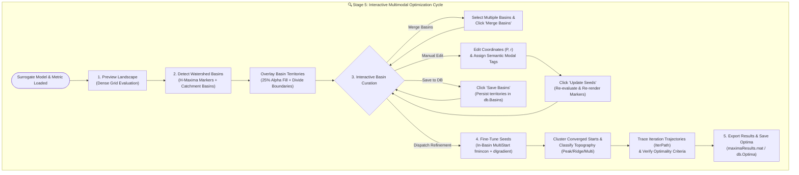

# ☄️ Optimization & Multimodal Basin Curation Workflow Guide

**Framework:** ☄️ ASSTEROID Optimization Engine (🔍 Stage 5) — Version 5.3  
**Associated Scripts:** [`scripts/apps/assteroid_app.m`](../scripts/apps/assteroid_app.m), [`scripts/pipeline/run_locate_maxima.m`](../scripts/pipeline/run_locate_maxima.m), [`src/orchestration/runLocalizationWorkflow.m`](../src/orchestration/runLocalizationWorkflow.m), [`src/modeling/detect_watershed_basins.m`](../src/modeling/detect_watershed_basins.m), [`src/modeling/find_local_maxima.m`](../src/modeling/find_local_maxima.m)  
**Manuscript Reference:** Supplementary Note 2, Sections S2.1.2 (Stages 4–5) & S2.6 (*Dense Parameter-Space Exploration and Topology-Aware Local Maxima Extraction*)

---

## 1. Overview & Physical Rationale

In high-Q plasmonic arrays such as Nanoparticle-on-Mirror (NPoM) architectures, the optical response exhibits rich multimodal structure across $(P, r)$ parameter space. Distinct electromagnetic mechanisms—including:
- localized particle-film gap cavity modes,
- higher-order multipolar resonances,
- surface lattice resonances (SLRs) arising from in-plane radiative diffraction coupling, and
- Wood's anomaly grazing thresholds—

manifest as separate, isolated local extrema rather than a single monolithic optimum. Standard unconstrained global optimizers inevitably converge to whichever peak happens to have the highest single-objective amplitude, discarding secondary modes that may offer superior optical quality factors, broader operational fabrication tolerances, or reduced ohmic absorption.

To address this, ASSTEROID implements a **topology-aware, marker-controlled watershed exploration and in-basin multimodal refinement workflow**:
1. **Dense Grid Inference:** The deep neural surrogate evaluates metric landscapes across $> 10^6$ coordinates in seconds.
2. **Marker-Controlled Topological Watershed Partitioning:** The continuous landscape is inverted and partitioned into non-overlapping catchment basins using morphological extended $H$-maxima regional markers (`imextendedmax`), minima imposition (`imimposemin`), and the Meyer topological watershed transform (`watershed`).
3. **Quantitative Basin Characterization:** Each basin is rigorously characterized by its summit coordinates $\mathbf{x}_{\text{peak}}^{(k)}$, peak metric value $F_{\text{peak}}^{(k)}$, boundary saddle point elevation $F_{\text{saddle}}^{(k)}$, catchment area $\Omega_k$, and topological depth/prominence $\Delta F_{\text{prom}}^{(k)} = F_{\text{peak}}^{(k)} - F_{\text{saddle}}^{(k)}$.
4. **Interactive Basin Curation, Merging & Semantic Tagging:** Researchers inspect detected basins overlaid directly on 2D contour maps with distinct 25% transparent color fills matching seed markers, merge over-segmented saddle territories, prune boundary artifacts, adjust coordinates, and assign physical labels (e.g., *Seed 1*, *Mode I*, *SLR Dipole*).
5. **Persistent Cross-Metric Archiving (`db.Basins`):** Curated territories are stored in the project database, decoupled from specific metric values, enabling identical physical modal regions to be optimized across all 8 optical Enhancement Efficacy ($\mathrm{EE}$), Enhancement Factor ($\mathrm{EF}_{\max}^L$), and Absorptance ($\mathrm{Abs}^L$) targets.
6. **In-Basin Stratified MultiStart Gradient Ascent:** Localized MultiStart sequential quadratic programming (`fmincon` with SQP or Interior-Point) draws starting points strictly within the top 50% dynamic range of candidate catchment territory $\Omega_k$, refining parameters using analytical neural graph gradients (`dlgradient`) while enforcing physical packing constraints ($r/P \leq 0.49$) and jump-retry bound contraction.
7. **Trajectory Coalescence & Diagnostics:** Converged trajectories within each basin are clustered. The modal topography is classified as a sharp peak (`peak`), an elongated ridge (`ridge`), multiple internal sub-modes (`multi`), a single convergence (`single`), cross-basin duplicate (`duplicate of X`), or unrefined fallback (`fallback`).
8. **Relational Archiving:** Optimal coordinates, convergence trajectories, solver diagnostics, and basin metrics are permanently recorded in structured relational tables.

---

## 2. Interactive Graphical User Interface Workflows

The optimization canvas in ASSTEROID ([`ASSTEROID.m`](../ASSTEROID.m) / [`start_app.m`](../start_app.m)) provides reactive controls, live parameter verification, watershed basin boundary visualization, and immediate 2D contour feedback.



### Workflow A: Clean Start to Master Export

Use this sequence for standard end-to-end optimization of a trained surrogate model:
1. **Load Surrogate Model:** Ensure a validated ResNet model (`.mat`) and refractive index dispersion file are loaded.
2. **Select Target Metric:** Choose from canonical metrics (`EF_vol`, `EF_surf`, `Absorptance`) and variants (`avg`, `laser`, or `analyte`).
3. **Click `Preview Landscape`:** Generates and plots the dense 2D metric landscape across the specified $(P, r)$ domain.
4. **Click `Detect Basins`:** Executes marker-controlled watershed segmentation with specified sensitivity input (default 0.1% dynamic range). Basins are delineated with colored boundaries and filled with 25% transparent colors matching seed markers. The seed table displays each basin's Area, Depth, Saddle elevation, and summit coordinates.
5. **Click `Fine-Tune Seeds`:** Dispatches in-basin MultiStart `fmincon` from the active seeds. Converged optima are marked with distinct diamond symbols, optimization paths are drawn, and each basin's structural status (`peak`, `ridge`, etc.) is logged.
6. **Review Solver Outputs:** Inspect optimality criteria, exit flags, final metric values, and coalescence diagnostics.
7. **Click `Export Results` or `Save to DB`:** Saves results permanently to `maximaResults.mat` or directly into `db.Optima`.

### Workflow B: Interactive Seed Curation & Manual Editing

When physical intuition or experimental fabrication constraints dictate exploring specific geometries:
1. Generate or detect initial basins as in Workflow A.
2. **Edit Coordinates Directly:** In the interactive seed table, click on any `Period (P)` or `Radius (r)` cell and enter custom coordinates (in nm).
3. **Assign Semantic Tags:** Edit the `Tag` column with domain-specific labels (e.g., `"Mode II Quadrupole"`, `"SLR Target A"`).
4. **Prune Artifacts:** Uncheck basins located on numerical boundaries or fabrication-infeasible corners.
5. **Click `Update Seeds`:** Re-evaluates surrogate metrics at the edited coordinates, re-assigns seeds to their corresponding watershed basins, and updates markers on the contour plot.
6. **Click `Fine-Tune Seeds`:** Dispatches in-basin gradient refinement from the newly defined seed locations. The optimizer preserves all custom semantic tags in the exported results.

### Workflow C: Topological Basin Merging

If two adjacent sub-basins represent the same broad physical resonance mode separated by an artificial shallow saddle:
1. Select the checkboxes for the two (or more) basins in the seed table.
2. Click **Merge Basins**.
3. The application consolidates the label masks into a unified composite territory, recalculates the bounding box and total area, automatically elects the highest summit coordinate among them, and assigns the combined tag (e.g. `Seed 2 + Seed 3`).
4. All unselected seeds remain completely untouched.

### Workflow D: Multi-Metric Modal Tracking with Persistent Basins (`db.Basins`)

To evaluate trade-offs and build a comparative modal matrix (e.g. 10 modes $\times$ 7 optical metrics):
1. **Define Master Territories:** On a foundational volumetric metric (e.g. `EF_vol_avg`), preview the landscape, detect basins, merge any over-segmented modes, and refine seeds.
2. **Save Basins to Project DB:** Click **Save Basins**. The full territorial polygons, raster labels, summit locations, and tags are permanently committed to `session.db.Basins`.
3. **Switch Metric:** Change the metric selector to a secondary target (e.g. `EF_surf_avg`, `Absorptance_laser`, or `EF_vol_analyte`).
4. **Load Basins:** Click **Load Basins**. The exact physical modal boundaries and tags are restored over the new metric contour plot.
5. **Fine-Tune On New Metric:** Click **Fine-Tune Seeds**. The optimizer automatically samples starting points from the top 50% of the *active metric's landscape* within each saved territory and converges to the mode's peak for that specific optical target.
6. **Save to DB:** Click **Save to DB** under Optima. Repeat across all 7 metrics to build a complete modal catalog.

### Workflow E: Model Hot-Reloading

If you retrain the surrogate or swap between different network architectures:
1. Select the new model file in the model selector.
2. The application validates feature preprocessing flags (`FeatureLogTransform`, `IncludeRatios`, material dispersion metadata) against the active configuration.
3. Optimization state buffers are cleanly reset, ensuring that predictions originate strictly from the newly loaded weights.

---

## 3. Standalone Scriptable CLI Workflow

The optimization workflow is fully scriptable for automated headless execution or cluster environments using [`src/orchestration/localizeMaximaConfig.m`](../src/orchestration/localizeMaximaConfig.m) and [`src/orchestration/runLocalizationWorkflow.m`](../src/orchestration/runLocalizationWorkflow.m).

```matlab
% 1. Initialize environment
setup_project;

% 2. Define configuration structure
cfg = localizeMaximaConfig( ...
    WorkDir = pwd, ...
    ModelFile = "models/sers_dnn_model.mat", ...
    RiCsvFile = "src/io/DefaultRefractiveIndices.dat", ...
    Metric = "EF_vol", ...
    MetricVariant = "avg", ...
    PLimits = [500, 1400], ...
    RLimits = [50, 650], ...
    Resolution = 1.0, ...            % nm grid step
    WatershedSensitivity = 0.05, ... % H-maxima fraction (5% dynamic range)
    MinBasinArea = 10, ...           % Minimum basin size in pixels
    MaxCandidates = 20, ...          % Maximum basins to extract
    StartsPerSeed = 10, ...          % In-basin MultiStart trial count
    InBasinStarts = true, ...        % Confine starts strictly within catchment basin
    RefineAlgorithm = "sqp", ...     % "sqp" or "interior-point"
    OptTol = 1e-9, ...               % First-order optimality tolerance
    StepTol = 1e-5, ...              % Step size tolerance (nm)
    FunTol = 1e-6, ...               % Function value relative tolerance
    CoalesceDistance = 2.0, ...      % Coalescence clustering distance (nm)
    SaveResults = true, ...
    OutputFile = "maximaResults.mat");

% 3. Execute workflow with console progress reporting
reporter = ProgressReporter.console();
results = runLocalizationWorkflow(cfg, reporter);

% 4. Inspect converged local optima and basin metrics
disp(results.maximaResults(:, ["Tag", "period", "radius", "MetricValue", "BasinArea_nm2", "BasinDepth", "RefineStatus", "ExitFlag"]));
```

---

## 4. Optimization Engine Details

### Marker-Controlled Topological Watershed Segmentation

Rather than relying on local finite-difference gradient suppression which can suffer from staircase artifacts on flat neural manifolds, ASSTEROID v5.3 partitions the $(P, r)$ performance manifold into distinct topological catchment basins via morphological watershed analysis:

1. **Topological Inversion:** The objective metric landscape $F(P, r)$ is inverted to define a topographic relief surface $S(P, r) = -F(P, r)$, where optical peaks correspond to catchment minima and inter-modal barriers correspond to watershed divides.
2. **Extended $H$-Maxima Transformation:** Regional peak markers are extracted using morphological $H$-maxima transformation via reconstruction:
   $$M_H = \text{imextendedmax}(F, H)$$
   where the dynamic height threshold $H = h_{\text{frac}} \cdot (\max F - \min F)$ filters out numerical noise and sub-resolution ripples while preserving physically distinct resonant modes. In v5.3, $h_{\text{frac}}$ can be set via direct numerical input down to $0.0001\%$, allowing ultra-fine separation of close modes.
3. **Marker Imposition:** Spurious minima are suppressed by imposing regional markers into the inverted relief surface via morphological reconstruction:
   $$S_{\text{mod}} = \text{imimposemin}(S, M_H)$$
   guaranteeing that the subsequent watershed transform yields exactly one catchment basin per authenticated resonant mode without over-segmentation.
4. **Watershed Transformation:** The Meyer topological watershed transform evaluates catchment basins:
   $$L = \text{watershed}(S_{\text{mod}})$$
   producing an integer label matrix $L(P_i, r_j) \in \{1, \dots, N_{\text{basins}}\}$ and watershed ridge divides ($L = 0$).
5. **Basin Morphological Characterization:** For each basin $k$:
   - **Summit Coordinates:** $\mathbf{x}_{\text{peak}}^{(k)} = \arg\max_{\mathbf{x} \in \Omega_k} F(\mathbf{x})$.
   - **Catchment Area:** $\Omega_k = \sum_{(i,j) \in \text{Basin } k} \Delta P \Delta r$.
   - **Boundary Saddle Point Elevation:** $F_{\text{saddle}}^{(k)} = \max_{(i,j) \in \partial \Omega_k} F(P_i, r_j)$.
   - **Topological Basin Depth / Prominence:** $\Delta F_{\text{prom}}^{(k)} = F_{\text{peak}}^{(k)} - F_{\text{saddle}}^{(k)}$.

### In-Basin Stratified MultiStart Constrained Gradient Ascent (`fmincon`)

Each active basin is refined independently using a constrained multi-start optimization anchored strictly within its catchment territory:

$$\max_{\mathbf{x} = [P, r]^\top} \quad F(P, r)$$
$$\text{subject to} \quad \frac{r}{P} \leq 0.49, \quad P \in [P_{\min}^{(k)}, P_{\max}^{(k)}], \quad r \in [r_{\min}^{(k)}, r_{\max}^{(k)}]$$

1. **Top 50% Dynamic Range Starting Points:** For a quota of $N_{\text{start}}$ trials (default 5):
   - Trial 1 is initialized at the exact discrete summit $\mathbf{x}_{\text{peak}}^{(k)}$.
   - Trials $2, \dots, N_{\text{start}}$ are drawn strictly from candidate points in $\Omega_k$ satisfying:
     $$F(P_i, r_j) \geq F_{\min}^{(k)} + 0.50 \cdot (F_{\text{peak}}^{(k)} - F_{\min}^{(k)})$$
     ruling out low-elevation peripheral points that might wander into saddle divides. Farthest-point distance sampling is applied across the thresholded core to ensure stratified coverage.
2. **Analytical Neural Graph Gradients:** Objective gradients $\nabla_{\mathbf{x}} F(P, r)$ are computed via automatic differentiation (`dlgradient` / `dlfeval`) directly on the physical/logarithmic scale without finite-difference perturbation error.
3. **Jump Retry with 50% Summit Contraction:** If a gradient ascent trajectory escapes $\Omega_k$ and terminates inside an adjacent basin $\Omega_j$ ($j \neq k$), the algorithm discards the trajectory and triggers an in-basin retry with search bounds contracted by 50% around the summit:
   $$P \in [P_{\text{peak}} - 0.25 \Delta P_k, \, P_{\text{peak}} + 0.25 \Delta P_k], \quad r \in [r_{\text{peak}} - 0.25 \Delta r_k, \, r_{\text{peak}} + 0.25 \Delta r_k]$$
   guaranteeing interior convergence to the local mode.
4. **Trajectory Coalescence & Modal Classification:**
   All converged MultiStart runs within a basin are clustered by Euclidean distance:
   $$\|\mathbf{x}_a^* - \mathbf{x}_b^*\|_2 \leq d_{\text{coalesce}} \quad (\text{nominal } 2.0 \, \text{nm})$$
   The resulting landscape topography is classified:
   - `peak`: All or majority of starts coalesce to a single unique interior maximum.
   - `ridge`: Starts terminate at multiple distinct points of virtually identical elevation ($|\Delta F|/F < 10^{-4}$), indicating an elongated plateau or resonant ridge.
   - `multi`: Starts converge to multiple distinct local summits with measurable elevation differences, indicating fine sub-modal structure.
   - `single`: Single-start execution successfully converged.
   - `duplicate of X`: Optimization trajectory crossed a boundary saddle into an adjacent basin's primary peak.
   - `fallback`: Optimization failed to satisfy optimality tolerances; discrete basin summit is retained.

---

## 5. Output Data Schema & Relational Storage

### 1. Master Database Basin Branch (`db.Basins`)
Stores persistent modal territories decoupled from individual metric evaluations, enabling cross-metric optimization:
| Field | Type | Description |
|:---|:---|:---|
| `basinId` | `uint32(:)` | Unique basin identifier ($1, \dots, K$) |
| `tag` | `string(:)` | Semantic mode label (`Seed 1`, `Mode I`, etc.) |
| `period` | `double(:)` | Summit lattice period $P_{\text{peak}}$ (nm) |
| `radius` | `double(:)` | Summit particle radius $r_{\text{peak}}$ (nm) |
| `gridValue` | `double(:)` | Surrogate metric value at summit |
| `area` | `double(:)` | Real-space territory area ($\text{nm}^2$) |
| `saddle` | `double(:)` | Boundary saddle elevation |
| `depth` | `double(:)` | Topological depth / prominence |
| `pMin`, `pMax` | `double(:)` | Territory period bounding limits (nm) |
| `rMin`, `rMax` | `double(:)` | Territory radius bounding limits (nm) |
| `masterMetric` | `string` | Metric used when the basin was originally discovered |
| `polygons` | `struct(:)` | Closed boundary polygon coordinates (`BasinId`, `P_nm`, `R_nm`) |
| `labels` | `uint32(:,:)` | Full 2D label segmentation raster |
| `pAxis_nm`, `rAxis_nm` | `double(:)` | Spatial coordinates of the segmentation raster |

### 2. `maximaResults` Table (Exported MAT / `db.Optima`)
Summary table of converged local maxima and their topological basin metrics:
| Column | Type | Units | Description |
|:---|:---|:---|:---|
| `Tag` | `string` | — | Semantic mode label (*Seed 1*, *Mode I*, etc.) |
| `period` | `double` | nm | Optimized lattice period $P^*$ |
| `radius` | `double` | nm | Optimized nanoparticle radius $r^*$ |
| `diameter` | `double` | nm | Particle diameter $D^* = 2r^*$ |
| `MetricValue` | `double` | — | Predicted objective metric value at $(P^*, r^*)$ |
| `ExitFlag` | `int32` | — | Solver termination flag ($>0$ indicates successful convergence) |
| `Iterations` | `int32` | — | Number of gradient iterations required |
| `FirstOrderOpt` | `double` | — | First-order optimality measure ($\|\nabla L_{\text{Lagrange}}\|_{\infty}$) |
| `BasinArea_nm2` | `double` | $\text{nm}^2$ | Real-space surface area of the catchment basin $\Omega_k$ |
| `BasinDepth` | `double` | — | Topological prominence $\Delta F_{\text{prom}} = F_{\text{peak}} - F_{\text{saddle}}$ |
| `BasinSaddle` | `double` | — | Lowest boundary saddle pass elevation $F_{\text{saddle}}$ |
| `RefineStatus` | `string` | — | Modal structure classification (`peak`, `ridge`, `multi`, `single`, `fallback`) |

### 3. `allLocalRuns` Table
Detailed record of all individual MultiStart trials across all basins, including starting coordinates, convergence points, final objective values, and solver exit flags.

### 4. `attemptTrajectories` Table
Contains high-resolution iteration coordinate histories (`IterPath`) documenting the step-by-step optimization path of each solver trajectory through $(P, r)$ space. These trajectories are directly visualizable on the 2D contour canvas.

---

## 6. Defensive Architecture & Troubleshooting

| Symptom | Probable Cause | Built-in Resolution / Recommended Action |
|:---|:---|:---|
| `"No seeds selected"` | Table checkboxes are empty | Check at least one seed row in the table before clicking *Fine-Tune Seeds*. |
| `"Invalid coordinates skipped"` | Non-numeric or NaN entries entered manually | Table parser automatically discards non-finite values and logs a console warning. |
| Stale markers visible after metric switch | Cross-metric cache contamination | Automatically resolved: switching metrics triggers `resetOptimizeState(optimize, false)` to purge cached previews and basins. |
| Optimizer converges to boundary ($r/P = 0.49$) | Peak lies outside physical packing threshold | Normal physical behavior for configurations where enhancement increases monotonically with particle density. Inspect boundary behavior in Stage 6. |
| Basin detected as `ridge` | Flat elongated resonance valley/ridge | Normal physical behavior for broadband surface lattice modes. The summit coordinate with highest metric value is archived. |
| Basin labeled as `fallback` | Solver failed to find interior gradient stationary point | Original discrete watershed summit is safely preserved to prevent data loss. |
| Slow MultiStart refinement | Dense candidate count on CPU | Reduce `StartsPerSeed` or leverage the Parallel Computing Toolbox (`UseParallel = true`). |
