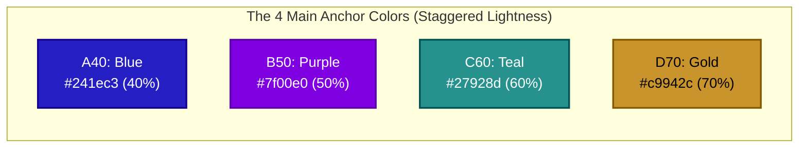

# ASSTEROID Scientific Color Palette Reference

> **Source**: `Codebase/ASSTEROID/docs/Pallette.svg`  
> **Color Model**: OKHSL (Perceptually Uniform Cylindrical Color Space)  
> **Accompanying Files**: [`palette.css`](palette.css), [`palette.json`](palette.json), [`AssteroidColormap.txt`](../src/vis/AssteroidColormap.txt)

---

## 1. System Overview & OKHSL Architecture

The ASSTEROID color palette is built on the **OKHSL** color system, which provides perceptual lightness uniformity, smooth hue progression, and consistent chromatic saturation across displays.

The palette consists of **61 individual swatches** plus a **13-node continuous heatmap colormap**, categorized into:
- **Base Extremes (2)**: Pure White (`W`) and Pure Black (`K`).
- **4 Main Chromatic Series (46)**:
  - **Series A (Blue)**: 11 shades (`A10`–`A90`), Primary Anchor: **`A40`**
  - **Series B (Purple)**: 12 shades (`B10`–`B95`), Primary Anchor: **`B50`**
  - **Series C (Teal)**: 12 shades (`C12`–`C98`), Primary Anchor: **`C60`**
  - **Series D (Gold)**: 11 shades (`D15`–`D98`), Primary Anchor: **`D70`**
- **Sequential Heatmap Colormap (13 Nodes)**: Monotonic 0–100 ramp spanning Blue → Purple → Blend (`#725ec1`) → Teal → Gold.
- **Neutral Gray Series G (13)**: Grayscale ramp from near-black to bright white (`G10`–`G98`).

### OKHSL Lightness Scale Logic
The two-digit number in each swatch label represents its **perceptual brightness (lightness percentage)** in OKHSL:
- `10`–`20`: Deep, low-luminance shades for dark mode backgrounds, containers, and deep colormap baselines.
- `30`–`40`: Rich, saturated tones; `A40` sits here where deep blue reaches peak chroma.
- `50`–`60`: Mid-tones with high contrast; `B50` and `C60` provide optimal vibrancy.
- `70`: High-luminance warm tones; `D70` provides brilliant gold without clipping.
- `80`–`90`: Pastel/tint tiers for highlights, hover states, and upper colormap ramp.
- `95`–`98`: Near-white surface tints, light-mode backgrounds, and colormap apex.



---

## 2. The 4 Primary Anchor Colors

These four hues form the primary visual vocabulary for ASSTEROID UI elements, multi-trace scientific figures, and categorical data distinctions:

| Swatch | Label | Hue Family | Hex | RGB (0–255) | Normalized RGB `[r, g, b]` | OKHSL Lightness | Optimal Text Contrast | Primary Role |
| :---: | :---: | :---: | :---: | :---: | :---: | :---: | :---: | :--- |
| <span style="display:inline-block;width:18px;height:18px;background:#241ec3;border-radius:4px;border:1px solid #555;"></span> | **A40** | Blue | `#241ec3` | `(36, 30, 195)` | `[0.141, 0.118, 0.765]` | 40% | White (10.3:1) | Primary data trace, active tab, blue accent |
| <span style="display:inline-block;width:18px;height:18px;background:#7f00e0;border-radius:4px;border:1px solid #555;"></span> | **B50** | Purple | `#7f00e0` | `(127, 0, 224)` | `[0.498, 0.000, 0.878]` | 50% | White (7.1:1) | Secondary data trace, surrogate model curves |
| <span style="display:inline-block;width:18px;height:18px;background:#27928d;border-radius:4px;border:1px solid #555;"></span> | **C60** | Teal | `#27928d` | `(39, 146, 141)` | `[0.153, 0.573, 0.553]` | 60% | Black (5.6:1) | Tertiary trace, optimization targets, success |
| <span style="display:inline-block;width:18px;height:18px;background:#c9942c;border-radius:4px;border:1px solid #555;"></span> | **D70** | Gold | `#c9942c` | `(201, 148, 44)` | `[0.788, 0.580, 0.173]` | 70% | Black (7.8:1) | Highlight trace, Pareto front, warnings |

---

## 3. Sequential Heatmap Colormap (0 to 100 Ramp)

Designed for 2D spatial electromagnetic field maps, SERS hotspot distributions, and loss/fitness heatmaps. It features **monotonic perceptual lightness growth** from deep dark blue (`10%`) to brilliant incandescent gold (`98%`), with an intermediate transitional node (`#725ec1`) perfectly bridging the violet-to-teal boundary.

<div style="height: 36px; width: 100%; border-radius: 6px; background: linear-gradient(to right, #000117 0%, #030033 8%, #080050 16%, #3d0070 24%, #5d00a6 32%, #7f00e0 41%, #725ec1 50%, #27928d 59%, #48b2ac 68%, #6bd1cb 76%, #fcd99f 84%, #ffeccd 92%, #fff8eb 100%); border: 1px solid #555; margin-bottom: 14px;"></div>

### Colormap Nodes Specification

| Ramp % | Offset | Swatch | Node | Hex | RGB (0–255) | Normalized RGB `[r, g, b]` | Lightness | Regime / Role |
| :---: | :---: | :---: | :---: | :---: | :---: | :---: | :---: | :--- |
| **0%** | `0.00` | <span style="display:inline-block;width:16px;height:16px;background:#000117;border-radius:3px;border:1px solid #555;"></span> | **A10** | `#000117` | `(0, 1, 23)` | `[0.000, 0.004, 0.090]` | 10% | Deepest baseline / zero-signal floor |
| **8%** | `0.08` | <span style="display:inline-block;width:16px;height:16px;background:#030033;border-radius:3px;border:1px solid #555;"></span> | **A15** | `#030033` | `(3, 0, 51)` | `[0.012, 0.000, 0.200]` | 15% | Sub-threshold background noise |
| **16%** | `0.16` | <span style="display:inline-block;width:16px;height:16px;background:#080050;border-radius:3px;border:1px solid #555;"></span> | **A20** | `#080050` | `(8, 0, 80)` | `[0.031, 0.000, 0.314]` | 20% | Low-field perimeter |
| **24%** | `0.24` | <span style="display:inline-block;width:16px;height:16px;background:#3d0070;border-radius:3px;border:1px solid #555;"></span> | **B30** | `#3d0070` | `(61, 0, 112)` | `[0.239, 0.000, 0.439]` | 30% | Deep violet entry |
| **32%** | `0.32` | <span style="display:inline-block;width:16px;height:16px;background:#5d00a6;border-radius:3px;border:1px solid #555;"></span> | **B40** | `#5d00a6` | `(93, 0, 166)` | `[0.365, 0.000, 0.651]` | 40% | Moderate enhancement zone |
| **41%** | `0.41` | <span style="display:inline-block;width:16px;height:16px;background:#7f00e0;border-radius:3px;border:1px solid #555;"></span> | **B50** | `#7f00e0` | `(127, 0, 224)` | `[0.498, 0.000, 0.878]` | 50% | Saturated purple transition |
| **50%** | `0.50` | <span style="display:inline-block;width:16px;height:16px;background:#725ec1;border-radius:3px;border:1px solid #555;"></span> | **BC55** | `#725ec1` | `(114, 94, 193)` | `[0.447, 0.369, 0.757]` | 55% | **Median Pivot (Purple-to-Teal Blend)** |
| **59%** | `0.59` | <span style="display:inline-block;width:16px;height:16px;background:#27928d;border-radius:3px;border:1px solid #555;"></span> | **C60** | `#27928d` | `(39, 146, 141)` | `[0.153, 0.573, 0.553]` | 60% | Active plasmonic mode region |
| **68%** | `0.68` | <span style="display:inline-block;width:16px;height:16px;background:#48b2ac;border-radius:3px;border:1px solid #555;"></span> | **C70** | `#48b2ac` | `(72, 178, 172)` | `[0.282, 0.698, 0.675]` | 70% | High field intensity boundary |
| **76%** | `0.76` | <span style="display:inline-block;width:16px;height:16px;background:#6bd1cb;border-radius:3px;border:1px solid #555;"></span> | **C80** | `#6bd1cb` | `(107, 209, 203)` | `[0.420, 0.820, 0.796]` | 80% | Intense resonance sheath |
| **84%** | `0.84` | <span style="display:inline-block;width:16px;height:16px;background:#fcd99f;border-radius:3px;border:1px solid #555;"></span> | **D90** | `#fcd99f` | `(252, 217, 159)` | `[0.988, 0.851, 0.624]` | 90% | SERS hotspot entrance |
| **92%** | `0.92` | <span style="display:inline-block;width:16px;height:16px;background:#ffeccd;border-radius:3px;border:1px solid #555;"></span> | **D95** | `#ffeccd` | `(255, 236, 205)` | `[1.000, 0.925, 0.804]` | 95% | Core hotspot core |
| **100%** | `1.00` | <span style="display:inline-block;width:16px;height:16px;background:#fff8eb;border-radius:3px;border:1px solid #555;"></span> | **D98** | `#fff8eb` | `(255, 248, 235)` | `[1.000, 0.973, 0.922]` | 98% | **Maximum peak intensity ($\mathrm{EF}_{\max}^L$)** |

---

## 4. Base Extremes (Pure Black & White)

| Swatch | Label | Hex | RGB (0–255) | Normalized RGB | Lightness | Usage |
| :---: | :---: | :---: | :---: | :---: | :---: | :--- |
| <span style="display:inline-block;width:18px;height:18px;background:#ffffff;border-radius:4px;border:1px solid #ccc;"></span> | **W** | `#ffffff` | `(255, 255, 255)` | `[1.000, 1.000, 1.000]` | 100% | Pure white background, high-contrast markers |
| <span style="display:inline-block;width:18px;height:18px;background:#000000;border-radius:4px;border:1px solid #555;"></span> | **K** | `#000000` | `(0, 0, 0)` | `[0.000, 0.000, 0.000]` | 0% | Deepest black, true dark mode canvas |

---

## 5. Chromatic Series Reference Tables

### Series A: Blue (11 Shades)
*Primary Anchor: **`A40`***

| Swatch | Label | Hex | RGB (0–255) | Normalized RGB | Lightness | Recommended Application |
| :---: | :---: | :---: | :---: | :---: | :---: | :--- |
| <span style="display:inline-block;width:16px;height:16px;background:#000117;border-radius:3px;border:1px solid #444;"></span> | **A10** | `#000117` | `(0, 1, 23)` | `[0.000, 0.004, 0.090]` | 10% | Deep midnight background / colormap 0% node |
| <span style="display:inline-block;width:16px;height:16px;background:#020023;border-radius:3px;border:1px solid #444;"></span> | **A12** | `#020023` | `(2, 0, 35)` | `[0.008, 0.000, 0.137]` | 12% | Dark container background |
| <span style="display:inline-block;width:16px;height:16px;background:#030033;border-radius:3px;border:1px solid #444;"></span> | **A15** | `#030033` | `(3, 0, 51)` | `[0.012, 0.000, 0.200]` | 15% | Dark surface / panel background / colormap 8% node |
| <span style="display:inline-block;width:16px;height:16px;background:#080050;border-radius:3px;border:1px solid #444;"></span> | **A20** | `#080050` | `(8, 0, 80)` | `[0.031, 0.000, 0.314]` | 20% | Elevated card surface / colormap 16% node |
| <span style="display:inline-block;width:16px;height:16px;background:#16008e;border-radius:3px;border:1px solid #444;"></span> | **A30** | `#16008e` | `(22, 0, 142)` | `[0.086, 0.000, 0.557]` | 30% | Shaded fill / border highlight |
| <span style="display:inline-block;width:16px;height:16px;background:#241ec3;border-radius:3px;border:1px solid #444;"></span> | **A40** | `#241ec3` | `(36, 30, 195)` | `[0.141, 0.118, 0.765]` | 40% | **Main Blue Anchor (Primary Accent)** |
| <span style="display:inline-block;width:16px;height:16px;background:#384ae0;border-radius:3px;border:1px solid #444;"></span> | **A50** | `#384ae0` | `(56, 74, 224)` | `[0.220, 0.290, 0.878]` | 50% | Interactive hover state / bright trace |
| <span style="display:inline-block;width:16px;height:16px;background:#5d78da;border-radius:3px;border:1px solid #444;"></span> | **A60** | `#5d78da` | `(93, 120, 218)` | `[0.365, 0.471, 0.855]` | 60% | Secondary line / active indicator |
| <span style="display:inline-block;width:16px;height:16px;background:#809aec;border-radius:3px;border:1px solid #444;"></span> | **A70** | `#809aec` | `(128, 154, 236)` | `[0.502, 0.604, 0.925]` | 70% | Subtle highlight / badge border |
| <span style="display:inline-block;width:16px;height:16px;background:#a7bbf9;border-radius:3px;border:1px solid #444;"></span> | **A80** | `#a7bbf9` | `(167, 187, 249)` | `[0.655, 0.733, 0.976]` | 80% | Light badge fill / shaded confidence band |
| <span style="display:inline-block;width:16px;height:16px;background:#d1ddff;border-radius:3px;border:1px solid #444;"></span> | **A90** | `#d1ddff` | `(209, 221, 255)` | `[0.820, 0.867, 1.000]` | 90% | Soft tint / light selection background |

---

### Series B: Purple (12 Shades)
*Primary Anchor: **`B50`***

| Swatch | Label | Hex | RGB (0–255) | Normalized RGB | Lightness | Recommended Application |
| :---: | :---: | :---: | :---: | :---: | :---: | :--- |
| <span style="display:inline-block;width:16px;height:16px;background:#060011;border-radius:3px;border:1px solid #444;"></span> | **B10** | `#060011` | `(6, 0, 17)` | `[0.024, 0.000, 0.067]` | 10% | Deep purple dark canvas |
| <span style="display:inline-block;width:16px;height:16px;background:#0a0019;border-radius:3px;border:1px solid #444;"></span> | **B12** | `#0a0019` | `(10, 0, 25)` | `[0.039, 0.000, 0.098]` | 12% | Dark panel base |
| <span style="display:inline-block;width:16px;height:16px;background:#120026;border-radius:3px;border:1px solid #444;"></span> | **B15** | `#120026` | `(18, 0, 38)` | `[0.071, 0.000, 0.149]` | 15% | Dark surface elevation |
| <span style="display:inline-block;width:16px;height:16px;background:#1f003e;border-radius:3px;border:1px solid #444;"></span> | **B20** | `#1f003e` | `(31, 0, 62)` | `[0.122, 0.000, 0.243]` | 20% | Elevated card surface |
| <span style="display:inline-block;width:16px;height:16px;background:#3d0070;border-radius:3px;border:1px solid #444;"></span> | **B30** | `#3d0070` | `(61, 0, 112)` | `[0.239, 0.000, 0.439]` | 30% | Deep accent / colormap 24% node |
| <span style="display:inline-block;width:16px;height:16px;background:#5d00a6;border-radius:3px;border:1px solid #444;"></span> | **B40** | `#5d00a6` | `(93, 0, 166)` | `[0.365, 0.000, 0.651]` | 40% | Strong secondary accent / colormap 32% node |
| <span style="display:inline-block;width:16px;height:16px;background:#7f00e0;border-radius:3px;border:1px solid #444;"></span> | **B50** | `#7f00e0` | `(127, 0, 224)` | `[0.498, 0.000, 0.878]` | 50% | **Main Purple Anchor / colormap 41% node** |
| <span style="display:inline-block;width:16px;height:16px;background:#994ef3;border-radius:3px;border:1px solid #444;"></span> | **B60** | `#994ef3` | `(153, 78, 243)` | `[0.600, 0.306, 0.953]` | 60% | Hover state / vibrant trace |
| <span style="display:inline-block;width:16px;height:16px;background:#ad87ed;border-radius:3px;border:1px solid #444;"></span> | **B70** | `#ad87ed` | `(173, 135, 237)` | `[0.678, 0.529, 0.929]` | 70% | Light trace / active border |
| <span style="display:inline-block;width:16px;height:16px;background:#c8aef9;border-radius:3px;border:1px solid #444;"></span> | **B80** | `#c8aef9` | `(200, 174, 249)` | `[0.784, 0.682, 0.976]` | 80% | Confidence interval shading |
| <span style="display:inline-block;width:16px;height:16px;background:#e3d6ff;border-radius:3px;border:1px solid #444;"></span> | **B90** | `#e3d6ff` | `(227, 214, 255)` | `[0.890, 0.839, 1.000]` | 90% | Soft badge fill |
| <span style="display:inline-block;width:16px;height:16px;background:#f1ebff;border-radius:3px;border:1px solid #444;"></span> | **B95** | `#f1ebff` | `(241, 235, 255)` | `[0.945, 0.922, 1.000]` | 95% | Ultra-soft highlight tint |

---

### Series C: Teal (12 Shades)
*Primary Anchor: **`C60`***

| Swatch | Label | Hex | RGB (0–255) | Normalized RGB | Lightness | Recommended Application |
| :---: | :---: | :---: | :---: | :---: | :---: | :--- |
| <span style="display:inline-block;width:16px;height:16px;background:#000808;border-radius:3px;border:1px solid #444;"></span> | **C12** | `#000808` | `(0, 8, 8)` | `[0.000, 0.031, 0.031]` | 12% | Deep teal dark canvas |
| <span style="display:inline-block;width:16px;height:16px;background:#000e0e;border-radius:3px;border:1px solid #444;"></span> | **C15** | `#000e0e` | `(0, 14, 14)` | `[0.000, 0.055, 0.055]` | 15% | Dark surface base |
| <span style="display:inline-block;width:16px;height:16px;background:#001b1a;border-radius:3px;border:1px solid #444;"></span> | **C20** | `#001b1a` | `(0, 27, 26)` | `[0.000, 0.106, 0.102]` | 20% | Elevated card surface |
| <span style="display:inline-block;width:16px;height:16px;background:#003634;border-radius:3px;border:1px solid #444;"></span> | **C30** | `#003634` | `(0, 54, 52)` | `[0.000, 0.212, 0.204]` | 30% | Subtle background element |
| <span style="display:inline-block;width:16px;height:16px;background:#005350;border-radius:3px;border:1px solid #444;"></span> | **C40** | `#005350` | `(0, 83, 80)` | `[0.000, 0.325, 0.314]` | 40% | Deep teal border |
| <span style="display:inline-block;width:16px;height:16px;background:#00736e;border-radius:3px;border:1px solid #444;"></span> | **C50** | `#00736e` | `(0, 115, 110)` | `[0.000, 0.451, 0.431]` | 50% | Strong teal accent |
| <span style="display:inline-block;width:16px;height:16px;background:#27928d;border-radius:3px;border:1px solid #444;"></span> | **C60** | `#27928d` | `(39, 146, 141)` | `[0.153, 0.573, 0.553]` | 60% | **Main Teal Anchor / colormap 59% node** |
| <span style="display:inline-block;width:16px;height:16px;background:#48b2ac;border-radius:3px;border:1px solid #444;"></span> | **C70** | `#48b2ac` | `(72, 178, 172)` | `[0.282, 0.698, 0.675]` | 70% | Bright data trace / colormap 68% node |
| <span style="display:inline-block;width:16px;height:16px;background:#6bd1cb;border-radius:3px;border:1px solid #444;"></span> | **C80** | `#6bd1cb` | `(107, 209, 203)` | `[0.420, 0.820, 0.796]` | 80% | Light highlight / colormap 76% node |
| <span style="display:inline-block;width:16px;height:16px;background:#a0efe9;border-radius:3px;border:1px solid #444;"></span> | **C90** | `#a0efe9` | `(160, 239, 233)` | `[0.627, 0.937, 0.914]` | 90% | Soft badge fill |
| <span style="display:inline-block;width:16px;height:16px;background:#c2fcf7;border-radius:3px;border:1px solid #444;"></span> | **C95** | `#c2fcf7` | `(194, 252, 247)` | `[0.761, 0.988, 0.969]` | 95% | Ultra-light tint |
| <span style="display:inline-block;width:16px;height:16px;background:#e4fffc;border-radius:3px;border:1px solid #444;"></span> | **C98** | `#e4fffc` | `(228, 255, 252)` | `[0.894, 1.000, 0.988]` | 98% | Crisp icy-white background tint |

---

### Series D: Gold (11 Shades)
*Primary Anchor: **`D70`***

| Swatch | Label | Hex | RGB (0–255) | Normalized RGB | Lightness | Recommended Application |
| :---: | :---: | :---: | :---: | :---: | :---: | :--- |
| <span style="display:inline-block;width:16px;height:16px;background:#110a00;border-radius:3px;border:1px solid #444;"></span> | **D15** | `#110a00` | `(17, 10, 0)` | `[0.067, 0.039, 0.000]` | 15% | Deep bronze base |
| <span style="display:inline-block;width:16px;height:16px;background:#201300;border-radius:3px;border:1px solid #444;"></span> | **D20** | `#201300` | `(32, 19, 0)` | `[0.125, 0.075, 0.000]` | 20% | Dark amber surface |
| <span style="display:inline-block;width:16px;height:16px;background:#3e2900;border-radius:3px;border:1px solid #444;"></span> | **D30** | `#3e2900` | `(62, 41, 0)` | `[0.243, 0.161, 0.000]` | 30% | Deep gold container |
| <span style="display:inline-block;width:16px;height:16px;background:#5f4100;border-radius:3px;border:1px solid #444;"></span> | **D40** | `#5f4100` | `(95, 65, 0)` | `[0.373, 0.255, 0.000]` | 40% | Brownish-gold border |
| <span style="display:inline-block;width:16px;height:16px;background:#825b00;border-radius:3px;border:1px solid #444;"></span> | **D50** | `#825b00` | `(130, 91, 0)` | `[0.510, 0.357, 0.000]` | 50% | Medium bronze accent |
| <span style="display:inline-block;width:16px;height:16px;background:#a77600;border-radius:3px;border:1px solid #444;"></span> | **D60** | `#a77600` | `(167, 118, 0)` | `[0.655, 0.463, 0.000]` | 60% | Warm gold trace |
| <span style="display:inline-block;width:16px;height:16px;background:#c9942c;border-radius:3px;border:1px solid #444;"></span> | **D70** | `#c9942c` | `(201, 148, 44)` | `[0.788, 0.580, 0.173]` | 70% | **Main Gold Anchor (Pareto / Highlights)** |
| <span style="display:inline-block;width:16px;height:16px;background:#ebb34f;border-radius:3px;border:1px solid #444;"></span> | **D80** | `#ebb34f` | `(235, 179, 79)` | `[0.922, 0.702, 0.310]` | 80% | Bright warm highlight / hover state |
| <span style="display:inline-block;width:16px;height:16px;background:#fcd99f;border-radius:3px;border:1px solid #444;"></span> | **D90** | `#fcd99f` | `(252, 217, 159)` | `[0.988, 0.851, 0.624]` | 90% | Soft champagne / colormap 84% node |
| <span style="display:inline-block;width:16px;height:16px;background:#ffeccd;border-radius:3px;border:1px solid #444;"></span> | **D95** | `#ffeccd` | `(255, 236, 205)` | `[1.000, 0.925, 0.804]` | 95% | Warm cream tint / colormap 92% node |
| <span style="display:inline-block;width:16px;height:16px;background:#fff8eb;border-radius:3px;border:1px solid #444;"></span> | **D98** | `#fff8eb` | `(255, 248, 235)` | `[1.000, 0.973, 0.922]` | 98% | Off-white apex / colormap 100% node |

---

### Series G: Neutral Grays (13 Shades)

| Swatch | Label | Hex | RGB (0–255) | Normalized RGB | Lightness | UI Hierarchy Role |
| :---: | :---: | :---: | :---: | :---: | :---: | :--- |
| <span style="display:inline-block;width:16px;height:16px;background:#030303;border-radius:3px;border:1px solid #444;"></span> | **G10** | `#030303` | `(3, 3, 3)` | `[0.012, 0.012, 0.012]` | 10% | Root canvas / deep dark background |
| <span style="display:inline-block;width:16px;height:16px;background:#060606;border-radius:3px;border:1px solid #444;"></span> | **G12** | `#060606` | `(6, 6, 6)` | `[0.024, 0.024, 0.024]` | 12% | App container background |
| <span style="display:inline-block;width:16px;height:16px;background:#0b0b0b;border-radius:3px;border:1px solid #444;"></span> | **G15** | `#0b0b0b` | `(11, 11, 11)` | `[0.043, 0.043, 0.043]` | 15% | Surface / panel background |
| <span style="display:inline-block;width:16px;height:16px;background:#161616;border-radius:3px;border:1px solid #444;"></span> | **G20** | `#161616` | `(22, 22, 22)` | `[0.086, 0.086, 0.086]` | 20% | Elevated card / modal background |
| <span style="display:inline-block;width:16px;height:16px;background:#2e2e2e;border-radius:3px;border:1px solid #444;"></span> | **G30** | `#2e2e2e` | `(46, 46, 46)` | `[0.180, 0.180, 0.180]` | 30% | Input background / subtle dividers |
| <span style="display:inline-block;width:16px;height:16px;background:#484848;border-radius:3px;border:1px solid #444;"></span> | **G40** | `#484848` | `(72, 72, 72)` | `[0.282, 0.282, 0.282]` | 40% | Disabled control borders / muted icons |
| <span style="display:inline-block;width:16px;height:16px;background:#636363;border-radius:3px;border:1px solid #444;"></span> | **G50** | `#636363` | `(99, 99, 99)` | `[0.388, 0.388, 0.388]` | 50% | Strong borders / placeholder text |
| <span style="display:inline-block;width:16px;height:16px;background:#808080;border-radius:3px;border:1px solid #444;"></span> | **G60** | `#808080` | `(128, 128, 128)` | `[0.502, 0.502, 0.502]` | 60% | Secondary captions / grid lines |
| <span style="display:inline-block;width:16px;height:16px;background:#9e9e9e;border-radius:3px;border:1px solid #444;"></span> | **G70** | `#9e9e9e` | `(158, 158, 158)` | `[0.620, 0.620, 0.620]` | 70% | Secondary text (dark mode) / borders (light mode) |
| <span style="display:inline-block;width:16px;height:16px;background:#bebebe;border-radius:3px;border:1px solid #444;"></span> | **G80** | `#bebebe` | `(190, 190, 190)` | `[0.745, 0.745, 0.745]` | 80% | Body text (high contrast dark) / dividers |
| <span style="display:inline-block;width:16px;height:16px;background:#dedede;border-radius:3px;border:1px solid #444;"></span> | **G90** | `#dedede` | `(222, 222, 222)` | `[0.871, 0.871, 0.871]` | 90% | High-contrast text / light mode card |
| <span style="display:inline-block;width:16px;height:16px;background:#eeeeee;border-radius:3px;border:1px solid #444;"></span> | **G95** | `#eeeeee` | `(238, 238, 238)` | `[0.933, 0.933, 0.933]` | 95% | Near-white surface / light mode panel |
| <span style="display:inline-block;width:16px;height:16px;background:#f8f8f8;border-radius:3px;border:1px solid #444;"></span> | **G98** | `#f8f8f8` | `(248, 248, 248)` | `[0.973, 0.973, 0.973]` | 98% | Primary text (dark mode) / light canvas |

---

## 6. Usage in Code & Scientific Toolchains

### CSS Heatmap Bar & Gradients
```css
@import url('palette.css');

/* Full-width interactive heatmap scale bar */
.colorbar-preview {
  background: var(--gradient-heatmap);
  height: 20px;
  border-radius: 4px;
}
```

### MATLAB Colormap Integration
The colormap text specification resides at [`Codebase/ASSTEROID/src/vis/AssteroidColormap.txt`](../src/vis/AssteroidColormap.txt).

```matlab
% Load and interpolate the 13-node colormap to 256 smooth levels:
cmapPath = fullfile(pwd, "Codebase", "ASSTEROID", "src", "vis", "AssteroidColormap.txt");
cmap256  = loadColormap(cmapPath, 256);

% Apply directly to 2D field enhancement heatmap:
figure;
imagesc(x_grid, y_grid, log10(localEF));
colormap(cmap256);
cb = colorbar;
ylabel(cb, 'log_{10}(EF(\mathbf{r}))', 'FontSize', 11);
styleDarkAxes(gca, 'X (\mu m)', 'Y (\mu m)', 'Near-Field Spatial Distribution');
```
