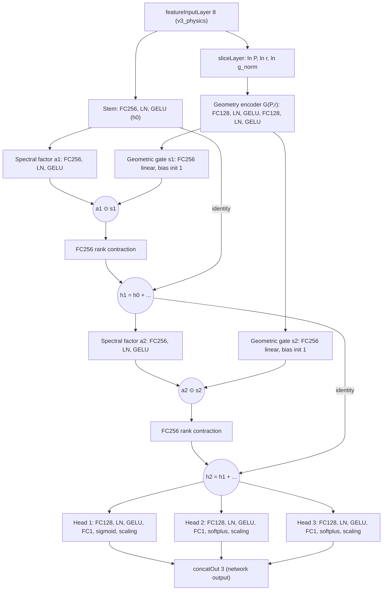

# Proposal (rev. 2): Geometry–Spectrum Factorized Tensor Network (`gs_tensor`)

> [!NOTE]
> **Status: implemented in ASSTEROID v6.3.0** (`src/modeling/buildSurrogateNetwork.m`, `surrogateHeadSpecs.m`, `buildPhysicsFeatures.m` `v3_physics`, Stage 3 UI). This is the design proposal that motivated the implementation; the ablation campaign (Phase 5) and the manuscript update (Phase 7) are pending a full training run.

**A leaner, physics-structured surrogate backbone for ASSTEROID, re-evaluated against the full MATLAB R2026b layer catalog**

> [!NOTE]
> **What changed in rev. 2.** I checked every layer category in the locally installed R2026b Deep Learning Toolbox (§6). The **core topology stays the same**: it follows from the physics and the shape of the dataset, not from which layers were allowed. Four upgrades are adopted:
> 1. `sliceLayer` replaces the frozen-FC selector.
> 2. Heads are physically bounded: `sigmoidLayer` for $\mathrm{Abs}$, `softplusLayer` for the log-transformed $\mathrm{EE}_D$.
> 3. A fixed `scalingLayer` does the target z-scoring inside the network.
> 4. The no-op `regression` identity layer is removed.
>
> Two higher-risk research tracks are noted separately (§6.3).

| | Current `tensor_resnet` | Proposed `gs_tensor` (default) | Proposed `gs_tensor` (lite) |
|---|---|---|---|
| Input features | 9 (with `h_over_lambda`) | **8** (`v3_physics`) | 8 |
| Trainable parameters | **2,546,691** | **450,435** (5.7× fewer) | 254,883 (10× fewer) |
| Parameters per training target value* | ≈ 7.0 | ≈ 1.2 | ≈ 0.7 |
| Redundant input paths | 4 (`proj1`, `concat_mid`, `proj2`, `concat_head`) | 0 | 0 |
| Learned skip projections | 2 (272k params) | 0 (identity skips) | 0 |
| Multiplicative (tensor) interactions | 1 (ad hoc factors) | 2 (geometry × spectrum) | 2 |
| Output physical bounds | Post-hoc hard clamp $\max(\cdot, 0)$ | **Built in and smooth**: $\mathrm{Abs} \in (0,1)$, $\mathrm{EE}_D \geq 0$ | same |
| Single-input API (`predict(model.net, X)`) | ✓ | ✓ | ✓ |

\*About 122k training samples (119 iterations/epoch × 1024) × 3 targets ≈ 3.7 × 10⁵ target values.

Companion diagram: `gs_tensor_proposal.mmd`. Export with `./export_diagram.ps1 gs_tensor_proposal.mmd`.

---

## 1. Short answer: do we still need the gap feature?

**No.** With $h_{\text{gap}} = 5\text{ nm}$ fixed, $h_{\text{gap}}/\lambda$ is $1/\lambda$ times a constant. After z-scoring it is exactly the standardized $1/\lambda$, so it adds no new information.

I checked this numerically on the real 785–1171 nm Stokes grid, using makima-interpolated Au data (`scratch script`):

| Feature that depends only on λ | Pearson r vs $\ln\lambda$ | $R^2$ of a **quadratic** in $\ln\lambda$ |
|---|---|---|
| $h_{\text{gap}}/\lambda$ (equal to the Raman shift up to an affine map) | −0.9986 | 0.999997 |
| $\varepsilon_1(\lambda)$ | −0.9948 | 0.99989 |
| $\varepsilon_2(\lambda)$ | +0.9902 | 0.99990 |

Over our window (λ spans only a factor of 1.5), every λ-only feature is a near-perfect quadratic of $\ln\lambda$.

- **Drop** $h_{\text{gap}}/\lambda$. It returns only if $h_{\text{gap}}$ becomes a design variable (§8).
- **Keep** $\varepsilon_1, \varepsilon_2$ deliberately, as a *material descriptor*. They cost 512 parameters, preserve portability to Ag/Al or multi-material training, and match the manuscript's dispersion narrative. Ablation A6 tests dropping them.

> [!NOTE]
> In the current `netdiagmermaid.mmd`, the particle–mirror gap node feeds $g_{\text{norm}}$. In code, `g_norm = (P - 2r)/P` is the **lateral** opening, which is unrelated to the vertical gap. The proposal diagram corrects this.

---

## 2. Redundancy audit of the current `tensor_resnet`

Topology is taken from [`localBuildDefaultNetwork`](../../src/modeling/train_surrogate_dnn.m#L663-L780). Parameter counts are hand-calculated from the layer widths, assuming 9 inputs.

| Component | Params | Share | Verdict |
|---|---:|---:|---|
| `fc1a` + `bn1a` | 3,072 | 0.1% | OK |
| `fc1b` + `bn1b` | 132,608 | 5.2% | OK, but wider than needed |
| `proj1` | 5,120 | 0.2% | **Redundant**: spans the same 9D subspace as the `input` slice of `concat_mid` (no nonlinearity in between) |
| `fc2a` + `bn2a` (1024 expansion) | 536,576 | 21.1% | **Oversized** |
| `tt_core_a` + norm | 525,824 | 20.6% | Oversized |
| `tt_core_b` + norm | 6,144 | 0.2% | Rank-9 linear factor; GELU on both factors before `⊙` suppresses signed interference |
| `fc2b` + `bn2b` | 263,680 | 10.4% | Needed (rank contraction) |
| `proj2` | 267,264 | 10.5% | **Redundant**: replaces a 0-parameter identity skip; its 9D slice duplicates `concat_head` |
| 3 heads (521 → 512 → 1) | 806,403 | 31.7% | **Oversized** |
| `regression` (identity `functionLayer`) | 0 | — | **No-op**: `trainnet` + `dlnetwork` uses no output layer; `concatOut` is already the output |
| **Total** | **2,546,691** | | |

---

## 3. Design principles

| # | Principle | Consequence |
|---|---|---|
| P1 | **Inject each piece of information once.** Use identity skips. | Remove `proj1`, `proj2`, `concat_mid`, `concat_head`. |
| P2 | **Respect the physics factorization.** Response ≈ $\sum_m A_m(P, r)\,L_m(\lambda; P, r)$. | A λ-blind geometry encoder $G(P, r)$ multiplicatively conditions a spectral-geometric stream. |
| P3 | **Honor the fixed pump.** At fixed $\lambda_L$, the pump excitation $G_L(P, r; \lambda_L)$ and the loading factors $\kappa_S, \kappa_V$ depend on geometry only. | They live in $G(P, r)$. This branch is the fixed-$\lambda_L$ reduction of a twin-frequency (pump × Stokes) core. |
| P4 | **Signed bilinear coupling** (Fano interference needs both signs). | Linear gate (no activation before `⊙`), bias initialized to 1. |
| P5 | **Features linearize the physics thresholds.** | $P/\lambda$ maps every hex-lattice Rayleigh anomaly to a fixed threshold ($2/\sqrt{3}, 2, 4/\sqrt{3}, \dots$). $\ln g_{\text{norm}}$ resolves the near-touching regime. |
| P6 | **Outputs obey physics by construction.** | Passivity $0 < \mathrm{Abs} < 1$ via sigmoid; non-negativity $\mathrm{EE}_D \geq 0$ via softplus. Both are smooth, unlike the current hard clamp, which has a kink in what `dlgradient` sees. |
| P7 | **Engineering invariance.** | Single 8D input; `predict`, `minibatchpredict`, and the `find_local_maxima` gradient path are unchanged. Only architecture-agnostic MATLAB built-ins are used (no custom layer classes). |

---

## 4. Proposed architecture

### 4.1 Topology (simplified; full styled version in the `.mmd`)

### 4.2 Forward equations

Let $\mathbf{x} \in \mathbb{R}^8$ be the standardized input, and let $\mathcal{S}$ be the channel slice that extracts $[\ln P, \ln r, \ln g_{\text{norm}}]$.

**Geometry encoder** (λ-blind):

$$\mathbf{g} = \mathrm{GELU}\big(\mathrm{LN}(\mathbf{W}_{g2}\,\mathrm{GELU}(\mathrm{LN}(\mathbf{W}_{g1}\,\mathcal{S}(\mathbf{x}) + \mathbf{b}_{g1})) + \mathbf{b}_{g2})\big) \in \mathbb{R}^{128}$$

**Stem**:

$$\mathbf{h}_0 = \mathrm{GELU}\big(\mathrm{LN}(\mathbf{W}_s\mathbf{x} + \mathbf{b}_s)\big) \in \mathbb{R}^{256}$$

**Geometry-conditioned bilinear residual block** $k = 1, 2$:

$$\mathbf{a}_k = \mathrm{GELU}\big(\mathrm{LN}(\mathbf{W}_{a,k}\mathbf{h}_{k-1} + \mathbf{b}_{a,k})\big), \qquad \mathbf{s}_k = \mathbf{W}_{s,k}\,\mathbf{g} + \mathbf{b}_{s,k}\;\;(\mathbf{b}_{s,k} \leftarrow \mathbf{1}\text{ at init})$$

$$\mathbf{h}_k = \mathbf{h}_{k-1} + \mathbf{W}_{o,k}\big(\mathbf{a}_k \odot \mathbf{s}_k\big) + \mathbf{b}_{o,k}$$

**Physically bounded heads.** With $u_m = \mathbf{w}_m^\top \mathrm{GELU}(\mathrm{LN}(\mathbf{W}_m \mathbf{h}_2 + \mathbf{b}_m)) + c_m$:

$$\widehat{Z}_1 = \frac{\sigma(u_1) - \mu_1}{\sigma_1}\;\Rightarrow\; \widehat{\mathrm{Abs}} = \sigma(u_1) \in (0, 1)$$

$$\widehat{Z}_m = \frac{\mathrm{softplus}(u_m) - \mu_m}{\sigma_m}\;\Rightarrow\; \log_{10}(1 + \widehat{\mathrm{EE}}_D) = \mathrm{softplus}(u_m) \geq 0, \quad m \in \{2, 3\}$$

The training loss (`peak_mse`) stays in the same standardized $Z$ space, so the loss and the target pipeline are unchanged. The scaling uses the training-split statistics $\mu_m, \sigma_m$ as fixed hyperparameters in `scalingLayer(Scale = 1/σ, Offset = −μ/σ)`.

**Interpretation.** $\mathbf{W}_{o,k}(\mathbf{a}_k \odot \mathbf{s}_k) = \sum_{r=1}^{256} \mathbf{w}_{o,r}\, a_{k,r}\, s_{k,r}$ is an exact rank-256 CP contraction. One factor is a spectral-geometric mode function $a_r(P, r, \lambda)$; the other is a purely geometric amplitude $s_r(P, r)$. This is the discrete analogue of $\sum_m A_m(P, r)\,L_m(\lambda; P, r)$, and it is where the fixed-pump excitation and $\kappa_D$ enter.

### 4.3 Layer inventory (11 types, all MATLAB built-ins)

| Type | MATLAB layer | Where | Learnable |
|---|---|---|---|
| Feature input | `featureInputLayer` | `input` | — |
| Channel slice | `sliceLayer` (R2026b) | `geo_slice` | 0 |
| Fully connected | `fullyConnectedLayer` | everywhere | ✓ |
| Layer normalization | `layerNormalizationLayer` | after each hidden FC | ✓ |
| GELU activation | `geluLayer` | hidden activations | — |
| Element-wise multiplication | `multiplicationLayer` | `bk_mult` | — |
| Addition | `additionLayer` | identity skips | — |
| Sigmoid | `sigmoidLayer` | `head_1_bound` | — |
| Softplus | `softplusLayer` | `head_2_bound`, `head_3_bound` | — |
| Fixed scaling | `scalingLayer` | `head_k_zscore` | 0 (hyperparameters) |
| Concatenation | `concatenationLayer` | `concatOut` (network output) | — |

**Removed:** the `regression` identity `functionLayer`, and the frozen-FC selector from rev. 1.

### 4.4 Parameter budget (default: `modelWidth = 256`, `geoWidth = 128`, `numBlocks = 2`, `headHiddenSizes = 128`)

| Component | Layers | Params |
|---|---|---:|
| `geo_slice` | slice 8 → 3 | 0 |
| Geometry encoder | FC 3 → 128, LN, FC 128 → 128, LN | 17,536 |
| Stem | FC 8 → 256, LN | 2,816 |
| Block 1 | FC 256 → 256, LN, FC 128 → 256 (gate), FC 256 → 256 | 165,120 |
| Block 2 | same as Block 1 | 165,120 |
| Heads × 3 | FC 256 → 128, LN, FC 128 → 1, bound, scale | 99,843 |
| **Total trainable** | | **450,435** |

The **lite** variant (192 / 96 / 96) has 254,883 parameters. The **wide** variant (`modelWidth = 384`) has 862,723. Per-sample MACs scale roughly with parameter count, so dense prediction should run about 5× faster.

---

## 5. Feature schema `v3_physics` (8D)

| # | Name | Definition | Group | Change vs v2 |
|---|---|---|---|---|
| 1 | `log_p` | $\ln P\,[\mu\text{m}]$ | Geometry | — |
| 2 | `log_r` | $\ln r\,[\mu\text{m}]$ | Geometry | — |
| 3 | `log_lambda` | $\ln \lambda\,[\mu\text{m}]$ | Spectral | — |
| 4 | `eps1` | $n^2 - k^2$ | Spectral/material | — |
| 5 | `eps2` | $2nk$ | Spectral/material | — |
| 6 | `p_over_lambda` | $P/\lambda$ | Cross | — |
| 7 | `r_over_lambda` | $r/\lambda$ | Cross | — |
| 8 | `log_g_norm` | $\ln\big((P - 2r)/P\big)$ | Geometry | **$g_{\text{norm}} \to \ln g_{\text{norm}}$** |
| — | ~~`h_over_lambda`~~ | — | — | **Removed** |

**Why $\ln g_{\text{norm}}$:** gap-mode red-shift and field concentration follow power laws in the gap. With linear $g_{\text{norm}}$, the near-touching band $g_{\text{norm}} \in [0.02, 0.10]$ occupies **8.2%** of the feature range. With $\ln g_{\text{norm}}$ it occupies **41.1%**. The constraint $g_{\text{norm}} \geq 0.02$ keeps the log finite. Geometry slice indices are resolved **by feature name**.

> [!IMPORTANT]
> This also fixes two existing inconsistencies. (a) The manuscript says "8-input" while the trained model used 9 (GUI `includeVerticalGap` was on). (b) [paper_to_code_reference.md](../../docs/paper_to_code_reference.md#L264) lists log-forms that [buildPhysicsFeatures.m](../../src/modeling/buildPhysicsFeatures.m#L51-L53) does not use.

---

## 6. Full MATLAB layer-catalog review (R2026b, verified on the local install)

### 6.1 Why the core topology does not change

The architecture is set by the **structure of the data and of the downstream use**, not by the layer list:

- **Samples are pointwise** $(P, r, \lambda) \to \mathbf{Y}$. Each geometry has only 30 wavelengths on a **non-uniform** grid: Raman-shift spacing 0 → 100 → ~152 cm⁻¹ for 24 points, then 112.5 cm⁻¹ for the extended 5.
- **Downstream needs a continuous λ query.** That covers dense 1 cm⁻¹ quadrature for $\mathrm{EE}_D^{\text{broad}}$ and $\mathrm{EE}_D^{\text{analyte}}$, and comparisons against 201-wavelength FEM validation spectra. It also needs smooth analytic $\partial/\partial(P, r)$ for `fmincon` via `dlgradient`.
- **There is no spatial, temporal, or token axis** in a pointwise sample. That rules out the convolution, pooling, resizing, sequence, attention, and signal-transform families *for the main model* (§6.2).

### 6.2 Category-by-category verdicts

| Category | Layers considered | Verdict | Reason |
|---|---|---|---|
| **Input** | `featureInputLayer` (+ `Normalization="zscore"`), multiple inputs, `sequenceInputLayer`, `inputLayer` | Keep a single `featureInputLayer` | In-network z-scoring is attractive but optional (Phase C): saved models and `standardizeModelFeatures` rely on external standardization. Multi-input is unnecessary now that `sliceLayer` exists. |
| **Fully connected** | `fullyConnectedLayer`, `complexFullyConnectedLayer` | Keep real FC | Complex FC is the basis of research track R1. |
| **Convolution** | `convolution1dLayer`, `transposedConv1dLayer`, `groupedConvolution2dLayer`, `spectralConvolution1dLayer` (FNO) | Reject for main model | Needs a spectrum-as-sequence formulation: only 4,915 training *sequences* on a non-uniform 30-point grid, and continuous λ queries are lost. FNO kept as research track R2. |
| **Sequence / attention** | `lstmLayer`, `gruLayer`, `bilstmLayer`, `selfAttentionLayer`, `attentionLayer`, position embeddings | Reject | Same sequence-formulation issues. Treating the 8 features as tokens (FT-Transformer) adds cost with no expected gain at this scale. |
| **Activation** | `geluLayer`, `swishLayer`, `tanhLayer`, `eluLayer`, `preluLayer`, `sigmoidLayer`, `softplusLayer`, ReLU family | **GELU** for hidden layers (C∞, smooth Hessians). **Adopt sigmoid / softplus** as output bounds. Swish as an optional ablation. | ReLU-family activations produce piecewise-linear landscapes, which are bad for `fmincon` curvature. |
| **Normalization** | `layerNormalizationLayer`, `batchNormalizationLayer`, `groupNormalizationLayer`, `instanceNormalizationLayer`, `inverseNormalizationLayer` | Keep **LayerNorm** | Independent of batch composition, which matters for arbitrary-batch inference and `dlgradient`. `inverseNormalizationLayer` is an alternative to `scalingLayer` for in-network de-standardization. |
| **Dropout** | `dropoutLayer`, `spatialDropoutLayer` | Reject | Low overfitting risk at about 1.2 params per target value; stochastic training roughens the learned landscape. L2 is sufficient. |
| **Utility** | **`sliceLayer`**, **`scalingLayer`**, `functionLayer`, `identityLayer`, `networkLayer`, `reshapeLayer`, `permuteLayer`, `quadraticLayer`, `neuralODELayer` | **Adopt `sliceLayer` and `scalingLayer`.** `networkLayer` is optional for code tidiness, applied only to blocks (nested names would break the `head_k_out` lookup). `quadraticLayer` is rejected: its explicit pairwise monomials are subsumed by the learnable bilinear gates. `neuralODELayer` is rejected: continuous depth brings no benefit and is slower. | |
| **Pooling / resizing** | max/average/global pooling, `resize*` | N/A | No spatial axis. |
| **Combination** | `additionLayer`, `multiplicationLayer`, `concatenationLayer` | Keep all three | Core of the bilinear residual design. |
| **Signal transform** | `stftLayer`, `cwtLayer`, `modwtLayer` | Reject | Require time series. Only meaningful under the rejected spectrum-as-sequence formulation, and our 30-point spectra are too short and non-uniform. |
| **Output** | `regressionLayer` (legacy), identity `functionLayer` | **Remove** | `trainnet` takes the loss as an argument; a `dlnetwork` has no output layer. |

### 6.3 Research tracks (not proposed for this paper)

| Track | Idea | Upside | Why not now |
|---|---|---|---|
| **R1: Quasi-normal-mode (QNM) complex decoder** | The geometry branch predicts complex poles $\Omega_m(P,r)$ and residues $c_m(P,r)$ (`complexFullyConnectedLayer`, `realToComplexLayer`). The head evaluates $\big|\sum_m c_m/(\omega - \Omega_m)\big|^2$ (`complexToRealLayer` + `functionLayer`). | Exact rational (Lorentzian/Fano) structure in λ; very few parameters; interpretable resonances. | Pole fitting is notoriously non-convex. Modes cross or swap as $(P, r)$ vary. 30 λ samples per geometry cannot pin narrow lattice resonances. And $\mathrm{EE}_D$ is a spatially integrated two-frequency product, not a single modal sum. |
| **R2: Fourier neural operator (FNO) spectrum model** | Geometry → full spectrum with `spectralConvolution1dLayer`. | One forward pass per geometry (30× fewer); resolution-agnostic in principle. | Needs uniform, dense spectra (for example the 201-wavelength runs) for many geometries, and loses continuous λ queries on the present grid. |

---

## 7. Implementation plan (Code → Docs/Brain → Manuscript → Export)

### Phase 0: Baseline freeze
- Record A0 metrics: test/val $R^2$, NRMSE, NRMSE-IDW, peak-regime RMSE, final loss 1.4 × 10⁻³, split seed, watershed basins and optima. Tag the ASSTEROID commit.

### Phase 1: Feature schema `v3_physics`
- [buildPhysicsFeatures.m](../../src/modeling/buildPhysicsFeatures.m): add the `v3_physics` branch (column 8 = `log_g_norm`). Ignore `IncludeVerticalGap` with a warning. Leave `v2_physics` untouched.
- [prepare_training_dataset.m](../../src/modeling/prepare_training_dataset.m), `trainingConfig.m`, `runTrainingWorkflow.m`: accept `"v3_physics"`.
- `ensureModelFlags.m`, `isPhysicsSchemaModel.m`, `standardizeModelFeatures.m`, `predictSurrogateSpectrum.m`: dispatch on `featureSchema.Name` rather than assuming `"v2_physics"`.

### Phase 2: Architecture `gs_tensor` in [train_surrogate_dnn.m](../../src/modeling/train_surrogate_dnn.m)
- Config fields: `modelWidth = 256`, `geoWidth = 128`, `numBlocks = 2`, `headHiddenSizes = 128`, `geometryFeatures = ["log_p","log_r","log_g_norm"]`, `gateBiasInit = 1`, `zeroInitResidualOut = true`, `boundedHeads = true`, `hiddenActivation = "gelu"`.
- Validation: allow `["resnet","tensor_resnet","lean_resnet","gs_tensor"]`. Apply the `proj1`/`fc2b` constraints only to the legacy architectures.
- New `localBuildGsTensorNetwork(numFeatures, numTargets, config, featureNames, targetTransform)`:
  - `sliceLayer(1, geoIdx, Name="geo_slice")`. At implementation, confirm the channel dimension index for `"CB"` data and the output port name.
  - Gate FC with `BiasInitializer="ones"`. Residual-output FC with `WeightsInitializer="zeros"` when `zeroInitResidualOut` is set.
  - Heads: reuse `localBuildHeadLayers`, keep the names `head_k_out`, then add `sigmoidLayer` (Abs) or `softplusLayer` (log-targets, using `targetLogMask`). Finish with `scalingLayer(Scale=1/σ_k, Offset=-μ_k/σ_k)` from `dataset.targetTransform`.
  - Remove the `regression` identity layer **for `gs_tensor` only**; legacy builders stay unchanged.
- **Duan calibration:** for bounded heads, write $\alpha_m$ into `targetTransform.SmearingFactor`, which `denormalizeModelTargets` already applies (lines 92–93), instead of shifting the `head_k_out` bias. A bias shift before sigmoid/softplus is no longer an exact log shift. This exactly realizes the manuscript form $\widehat{Y}_m = \alpha_m(10^{\widehat{Z}_m} - 1)$.
- Data guard: clip $\mathrm{Abs}$ training targets to $[10^{-4}, 1 - 10^{-4}]$ before standardization. Log a warning if any raw value lies outside $[0, 1]$.
- Optional `lean_resnet` builder (stem + ungated residual blocks) for ablation A3.
- Continue-training guard when the pretrained architecture or schema does not match.

### Phase 3: GUI and controllers
- [TrainingController.m](../../src/app/controllers/TrainingController.m#L154) **and** the duplicate builder in `scripts/apps/assteroid_app.m` (around line 2950): add the new fields. Consider consolidating both into one helper.
- `training_tab.html`: architecture dropdown (`gs_tensor`, `lean_resnet`), width/depth fields, a bounded-heads toggle, feature schema v3 as default, and the vertical-gap checkbox disabled under v3.

### Phase 4: Tests (`tests/test_gs_tensor.m`)
1. Every layer class is in the allowed 11-type set.
2. Trainable parameter count is 450,435 (default config, 3 targets).
3. **λ-blindness:** perturbing columns 3–7 leaves `predict(net, X, Outputs="geo_gelu2")` unchanged.
4. **Bounds:** for random extreme inputs, the de-standardized $\mathrm{Abs} \in (0,1)$ and $\log_{10}(1+\mathrm{EE}_D) \geq 0$.
5. `dlgradient` is finite through the whole network, plus a `find_local_maxima` smoke test.
6. Save/load round trip, `predictSurrogateSpectrum` parity, and legacy v2/`tensor_resnet` models still load.
7. `buildPhysicsFeatures` v3: 8 columns, correct names, finite at $g_{\text{norm}} = 0.02$.

### Phase 5: Ablation campaign (same geometry-grouped split, seed, `peak_mse`, 1000 epochs)

| Run | Architecture | Features | Purpose |
|---|---|---|---|
| A0 | `tensor_resnet` | v2 + gap (9D) | Baseline |
| A1 | `tensor_resnet` | v2 (8D) | Gap redundancy |
| A2 | `tensor_resnet` | v3 | $\ln g_{\text{norm}}$ effect |
| A3 | `lean_resnet` | v3 | Pruning alone |
| **A4** | **`gs_tensor`** | v3 | **Proposal** |
| A5 | `gs_tensor` lite | v3 | Capacity floor |
| A6 | `gs_tensor` | v3 without $\varepsilon$ (6D) | Material-feature value |
| A7 | `gs_tensor`, `boundedHeads = false` | v3 | Cost/benefit of sigmoid/softplus |
| A8 | `gs_tensor`, `hiddenActivation = "swish"` | v3 | GELU vs SiLU |

LR sweep for the lean models: {1e-4, 3e-4, 1e-3}, same polynomial decay.

### Phase 6: Docs and Brain
- `paper_to_code_reference.md` §7 (also fix the feature-list inconsistency), `app_architecture.md`, `notation_table.md`.
- Surrogate concept in `Brain/Concepts/`.
- Promote `gs_tensor_proposal.mmd` to the canonical figure source.

### Phase 7: Manuscript
- `S02.tex`: features, backbone equations, bounded-head equations, figure, hyperparameter table.
- `03_methods.tex`: architecture name, parameter count, metrics.
- `build_manuscript.ps1`, then graphify update.

### Phase 8: Version
- **Minor** bump (new architecture and schema, backward-compatible loading). Enumerated commit, tag, push.

---

## 8. Acceptance criteria, risks, forward compatibility

| Criterion (A4 or A5 vs A0) | Threshold |
|---|---|
| Test $R^2$ per target | ≥ A0 − 0.001 (A0: 0.9963 / 0.9977 / 0.9963) |
| NRMSE and NRMSE-IDW | ≤ 1.10 × A0 |
| Peak-regime RMSE ($Z > 0.5$) | ≤ 1.10 × A0 |
| Final validation loss | ≤ 1.2 × A0 (≈ 1.7 × 10⁻³) |
| Watershed basins | Same set and labels |
| Surrogate optima per metric × basin | Within 2 nm in $P^*$ and $D^*$ (FEM re-verification remains the arbiter) |
| Gradient smoothness | Total variation of $\partial Z/\partial\lambda$ and $\partial Z/\partial P$ no worse than A0 |
| Parameter reduction | ≥ 4× |

| Risk | Mitigation |
|---|---|
| Under-fitting sharp SLR/RA lines | Capacity ladder lite → default → wide (0.86M); `numBlocks = 3` |
| Sigmoid saturation for near-perfect absorbers ($\sigma' \approx 0.02$ at $\mathrm{Abs} = 0.98$) | A7 ablation; fall back to an unbounded Abs head while keeping softplus for the $\mathrm{EE}$ heads |
| Gate instability | Bias-1 gate initialization + zero-initialized residual output (identity at init) |
| Calibration double-application | Bounded heads use only `SmearingFactor`; unit test asserts the head bias is untouched |
| `sliceLayer` is R2026b-only | ASSTEROID already targets R2026a/b. Fallback is a `functionLayer` slice (the precedent is the existing identity `functionLayer`) |
| Saved-model compatibility | Legacy builders and v2 schema kept; dispatch on the stored architecture and schema |

**Forward compatibility.**
- A swept $h_{\text{gap}}$: add $\ln h_{\text{gap}}$ to `geometryFeatures`.
- Multi-laser training: add $\ln\lambda_L$, $\varepsilon(\lambda_L)$, $P/\lambda_L$, $r/\lambda_L$ to the geometry slice, which then becomes a pump encoder and recovers the twin-frequency structure. The topology does not change.

---

## 9. Decisions needed before implementation

1. **$\varepsilon_1, \varepsilon_2$**: keep them as material descriptors (recommended), or go to 6D?
2. **$\ln g_{\text{norm}}$**: adopt it as the v3 default, conditional on A2? (Recommended.)
3. **Bounded heads**: adopt sigmoid/softplus by default, conditional on A7? (Recommended; softplus for the $\mathrm{EE}$ heads at minimum.)
4. **Ablation scope**: the full ladder A0–A8, or the minimal set A0 / A3 / A4 / A5 / A7?
5. **Doc location**: copy into `Codebase/ASSTEROID/docs/proposals/` when implementation starts?
